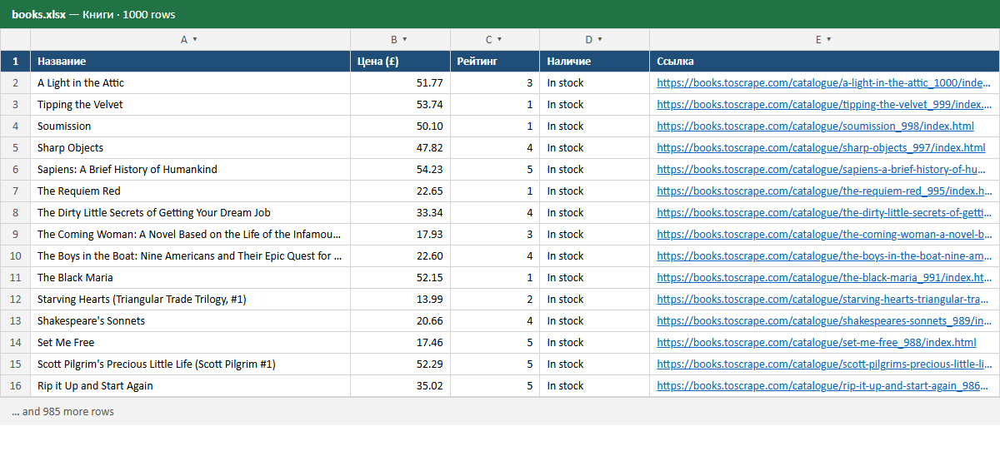

# Book Catalog Scraper → Excel / CSV

A Python web scraper that collects a full product catalog (1,000 items across 50 pages) and exports it into a clean, ready-to-use **Excel** spreadsheet and **CSV** file.

Demo target: [books.toscrape.com](https://books.toscrape.com), a sandbox site built for scraping practice.



## What it does

- Walks through **every page** of the catalog automatically (pagination)
- Extracts for each item: **title, price, rating (1–5), availability, product URL**
- Cleans the data: prices as numbers, ratings as integers, absolute links
- Exports to a **formatted Excel file** (styled header, filters, frozen top row, column widths) and a **CSV** file
- Polite crawling: delay between requests, timeouts, error handling

**Result:** 1,000 rows collected in about a minute.

## Tech stack

| Tool | Purpose |
|---|---|
| Python 3 | Language |
| `requests` | Downloading pages |
| `beautifulsoup4` | Parsing HTML |
| `openpyxl` | Building the Excel file |

## How to run

```bash
pip install -r requirements.txt
python parser.py
```

Output: `books.xlsx` and `books.csv` next to the script.

## Need something similar?

I build custom scrapers for any website: product catalogs, prices, contacts, listings, reviews.
You get clean data in **Excel, CSV, Google Sheets or JSON**, plus the script if you want to rerun it yourself.

---

### Кратко на русском

Парсер на Python: собирает весь каталог сайта (1000 товаров, 50 страниц) и сохраняет в оформленный Excel и CSV.
Делаю парсеры под заказ: товары, цены, контакты, объявления, с выгрузкой в Excel, CSV или Google Таблицы.
